# Case Study: High-Throughput Bulk Import in .NET 9 & PostgreSQL 17

**Scaling Worship Song Library Ingestion from 2,900 to 15,700 Items/Sec with FastIngest & Binary COPY**

- **Author:** Paul Abib Camano, Aebibtech
- **Project:** TeamChords v2 (Live Music & Worship Band Management Platform)
- **Tech Stack:** ASP.NET Core 9, PostgreSQL 17, FastIngest .NET, EF Core 9, SignalR, Redis 7, React Native / Expo
- **Date:** October 2026
- **Status:** Shipped to Production

---

## Executive Summary

When musicians, band directors, and worship teams migrate to **TeamChords v2**, they rarely start from scratch. They bring legacy song libraries containing anywhere from 200 to over 2,000 chord sheets formatted as ChordPro files (`.cho`, `.pro`), OnSong exports, CSV spreadsheets, and JSON archives.

Initially, importing large libraries suffered from a classic architectural dilemma: **client-side sequential imports** choked browser memory and network connections, while traditional **Entity Framework Core batching** hit a hard performance ceiling around ~2,900 items/second due to entity tracking and SQL generation overhead.

By adopting **FastIngest**—a high-throughput .NET data ingestion library utilizing PostgreSQL’s native binary `COPY` protocol (`COPY FROM STDIN (FORMAT BINARY)`)—we transformed bulk library onboarding:

1. **5.4x Latency Reduction**: Ingestion of 1,000 chord sheets dropped from **343.6 ms to 63.7 ms**.
2. **5.4x Throughput Scaling**: Ingestion throughput jumped from **2,910 items/sec to 15,710 items/sec**.
3. **Zero-Allocation Memory Footprint**: Bypassing ORM change tracking reduced server garbage collection thread allocations to negligible levels (**0 to 106 KB**).
4. **Resilient User Experience**: Replaced fragile HTTP polling with real-time row progress and instant library synchronization via **SignalR** and a **Redis backplane**.

---

## 1. The Architectural Challenge

### 1.1 The Domain & The Problem

In live music performance software, a "Chord Sheet" is not a simple string. It is a structured document containing metadata (Title, Artist, Key, Tempo, Time Signature, Capo, CCLI #) alongside lyric lines interspersed with musical chords (`[G]Amazing [D]grace, how [Em]sweet the [C]sound`).

```text
{title: Amazing Grace}
{artist: John Newton}
{key: G}

[G]Amazing grace, how [C]sweet the [G]sound
That saved a [D]wretch like me...
```

When a church or band registers a new organization on TeamChords, onboarding requires importing hundreds of `.cho` files or multi-megabyte JSON/CSV dumps. If this process is slow, drops connections, or freezes the client interface, user trust is destroyed during the critical first five minutes of onboarding.

### 1.2 The Dilemma: Client Memory vs. Server Capacity

The initial frontend implementation attempted to protect client device memory (especially on mobile devices running React Native / Expo) by parsing files locally and firing sequential HTTP POST requests:

```text
Total Duration = N × (HTTP RTT + Server Processing Latency)
```

For 500 songs with an average 40 ms network round-trip, this meant **over 25 seconds of loading spinners**, frequent mobile OS background kills, connection timeouts, and hundreds of individual database roundtrips.

We needed a unified, high-throughput bulk import pipeline that could:
- Accept multi-format inputs: Multipart Form-Data (file pickers), NDJSON streams, raw CSVs, or batch JSON arrays.
- Stream directly from the HTTP request into PostgreSQL without buffering gigabytes into memory.
- Provide live, granular progress updates back to the user interface.
- Maintain absolute tenant isolation and feature gate enforcement.

---

## 2. Evolution of Bulk Import Approaches

```mermaid
flowchart TD
    subgraph Approach 1: Client Fan-Out
        C1[Client Web/Mobile] -->|1 request per song| E1[POST /api/chordsheets]
        E1 -->|N roundtrips| DB1[(PostgreSQL)]
    end

    subgraph Approach 2: EF Core AddRange Batching
        C2[Client] -->|Bulk JSON Array| E2[POST /api/chordsheets/bulk]
        E2 -->|Chunk 50 + AddRange| EF[EF Core ChangeTracker]
        EF -->|Batched INSERT SQL| DB2[(PostgreSQL)]
    end

    subgraph Approach 3: FastIngest Binary COPY
        C3[Client] -->|NDJSON / CSV Stream| E3[POST /api/chordsheets/bulk]
        E3 -->|Streaming Channel| FI[FastIngest Pipeline]
        FI -->|NpgsqlBinaryImporter| DB3[(PostgreSQL Binary Heap)]
        FI -.->|Live Row Progress| HUB[SignalR + Redis] -.-> C3
    end
```



### Approach 1: Client-Side Sequential Fan-Out
- **Mechanism:** Client loops over files in JavaScript/TypeScript, parses each ChordPro file, and issues individual `POST /api/chordsheets` requests.
- **Pros:** Trivial to write; uses existing single-entity endpoint and validation.
- **Cons:** 
  - Massive connection overhead (*N* TLS handshakes, HTTP headers, authentication cycles).
  - High risk of client timeouts on mobile or cellular connections.
  - Vulnerable to rate-limiting middleware (authenticated permit limit is 600 req/min).
  - Clutters server request logs and Sentry tracing with thousands of repetitive spans.

### Approach 2: Server-Side EF Core Batching (`AddRange` + `ChangeTracker.Clear()`)
- **Mechanism:** Client uploads a single JSON payload containing an array of DTOs. The server parses the payload and inserts records in batches of 50:
  ```csharp
  for (int i = 0; i < dtos.Length; i += BatchSize)
  {
      var batch = dtos.Skip(i).Take(BatchSize).Select(d => d.ToEntity()).ToList();
      await db.ChordSheets.AddRangeAsync(batch);
      await db.SaveChangesAsync();
      db.ChangeTracker.Clear(); // Attempt to avoid memory explosion
  }
  ```
- **Pros:** Single HTTP connection; transactional per-batch isolation.
- **Cons:**
  - **Change Tracker Overhead:** Even with `ChangeTracker.Clear()`, EF Core must instantiate snapshot state, evaluate foreign key relationships, and compile SQL parameter lists for every entity.
  - **SQL Query Overhead:** Every batch generates parameterized multi-row `INSERT INTO "ChordSheets" (...) VALUES (...), (...)` statements that PostgreSQL must parse, plan, and execute.
  - **Throughput Plateau:** Throughput strictly plateaued at **~2,900 items/second**, regardless of whether batch size was set to 50, 100, or 250.

### Approach 3: Zero-Allocation Streaming with FastIngest & PostgreSQL Binary COPY
- **Mechanism:** Replaced EF Core with `FastIngestPipeline<ChordSheetIngestRecord>` and a custom `ChordSheetIngestionSink`.
- **How It Works:**
  1. The endpoint reads the incoming request stream directly (supporting NDJSON, CSV, or multipart file streams) without deserializing full collections into managed arrays.
  2. FastIngest pushes records through a bounded `System.Threading.Channels.Channel<T>` with backpressure.
  3. A dedicated background ingestion sink acquires an underlying `NpgsqlConnection` and opens a direct binary copy stream:
     ```csharp
     await using var writer = await conn.BeginBinaryImportAsync(
         $"COPY \"ChordSheets\" (\"{cols}\") FROM STDIN (FORMAT BINARY)", 
         cancellationToken);
     ```
  4. Columns are mapped and written in PostgreSQL's native wire binary format, bypassing all SQL parsing and query planning.
  5. Live row counters update a SignalR hub context, broadcasting progress to the client via WebSockets.

---

## 3. Implementation Details

### 3.1 The Minimal API Endpoint (`tcv2.Api/Endpoints/ChordSheetEndpoints.cs`)

The endpoint accepts `multipart/form-data`, `application/x-ndjson`, `text/csv`, or standard JSON, auto-detecting the schema and streaming directly into the pipeline:

```csharp
chordSheets.MapPost("/bulk", async (
    HttpRequest req, 
    AppDbContext db, 
    IHubContext<SetListHub, ISetListClient> hub, 
    ILogger<Program> logger, 
    CancellationToken cancellationToken) =>
{
    // 1. Authenticate & enforce multi-tenant organization boundary
    var auth = await EndpointHelpers.RequireOrgMember(req, db, targetOrgId, cancellationToken);
    if (auth != null) return auth;

    // 2. Feature gate check (tier limits)
    var org = await db.Organizations.FindAsync([targetOrgId], cancellationToken);
    var gate = FeatureGate.CheckBulkUpload(org);
    if (gate != null) return gate;

    // 3. Open raw database connection for binary COPY
    var connStr = db.Database.GetConnectionString();
    await using var npgsqlConn = new NpgsqlConnection(connStr);
    await npgsqlConn.OpenAsync(cancellationToken);

    // 4. Configure FastIngest Pipeline
    var pipeline = FastIngestPipeline<ChordSheetIngestRecord>.Create()
        .FromStream(inputStream, fileType)
        .WithMapping(m =>
        {
            m.Map(x => x.Id, "Id");
            m.Map(x => x.OrgId, "OrgId");
            m.Map(x => x.Title, "Title");
            m.Map(x => x.Artist, "Artist");
            m.Map(x => x.Content, "Content");
            m.Map(x => x.Key, "Key");
            m.Map(x => x.CreatedAt, "CreatedAt");
            m.Map(x => x.UpdatedAt, "UpdatedAt");
            m.Map(x => x.Version, "Version");
            m.Map(x => x.ClientMutationId, "ClientMutationId");
        })
        .ValidateWith(new ChordSheetIngestValidator(), opt => opt.ErrorStrategy = ErrorStrategy.CollectAndContinue)
        .WithBatchSize(1000)
        .WithChannelCapacity(2)
        .OnProgress(progress =>
        {
            if (!string.IsNullOrEmpty(connectionId))
            {
                var msg = $"Ingested {progress.RowsSucceeded:N0} songs...";
                _ = hub.Clients.Client(connectionId).BulkUploadProgress(
                    (int)progress.RowsProcessed, 
                    (int)progress.RowsProcessed, 
                    msg);
            }
        });

    var mappings = pipeline.GetMappings();
    var sink = new ChordSheetIngestionSink(npgsqlConn, targetOrgId, mappings);

    // 5. Execute binary ingestion under stopwatch & allocation telemetry
    var totalSw = Stopwatch.StartNew();
    var startAllocatedBytes = GC.GetAllocatedBytesForCurrentThread();

    var result = await pipeline.WriteToSinkAsync(sink, cancellationToken);

    totalSw.Stop();
    var totalElapsedMs = totalSw.Elapsed.TotalMilliseconds;
    var throughput = totalSw.Elapsed.TotalSeconds > 0 
        ? result.TotalProcessed / totalSw.Elapsed.TotalSeconds 
        : 0.0;
    var allocatedKb = Math.Max(0, GC.GetAllocatedBytesForCurrentThread() - startAllocatedBytes) / 1024.0;

    logger.LogInformation(
        "[BENCHMARK] FastIngest bulk chord sheet upload finished for Org {OrgId}: {Total} items ({Success} succeeded) in {TotalMs:F2}ms ({Throughput:F2} items/sec). Memory: {MemoryAllocatedKb:F2} KB.",
        targetOrgId, result.TotalProcessed, result.TotalSucceeded, totalElapsedMs, throughput, allocatedKb);

    // 6. Broadcast dual completion notifications
    var summary = new BulkUploadSummaryDto
    {
        CreatedIds = sink.CreatedIds.ToArray(),
        TotalProcessed = (int)result.TotalProcessed,
        Successful = (int)result.TotalSucceeded,
        Failed = (int)result.TotalFailed,
        ElapsedMilliseconds = Math.Round(totalElapsedMs, 2),
        ThroughputItemsPerSecond = Math.Round(throughput, 2),
        DbSaveMilliseconds = Math.Round(totalElapsedMs, 2)
    };

    await hub.Clients.Group(HubGroupNames.Organization(targetOrgId)).BulkUploadSummary(summary);
    if (!string.IsNullOrEmpty(connectionId))
    {
        await hub.Clients.Client(connectionId).BulkUploadSummary(summary);
        await hub.Clients.Client(connectionId).BulkUploadFinished();
    }

    return Results.Ok(summary);
});
```

### 3.2 The PostgreSQL Ingestion Sink (`ChordSheetIngestionSink.cs`)

The custom sink writes directly into the binary stream using `NpgsqlBinaryImporter`:

```csharp
public async Task<int> WriteBatchAsync(IReadOnlyList<ChordSheetIngestRecord> batch, CancellationToken cancellationToken)
{
    var copySql = $"COPY \"ChordSheets\" (\"{string.Join("\", \"", _columnNames)}\") FROM STDIN (FORMAT BINARY)";
    await using var writer = await _connection.BeginBinaryImportAsync(copySql, cancellationToken);

    int count = 0;
    foreach (var item in batch)
    {
        await writer.StartRowAsync(cancellationToken);
        
        var id = item.Id ?? Guid.NewGuid();
        _createdIds.Add(id);

        await writer.WriteAsync(id, NpgsqlDbType.Uuid, cancellationToken);
        await writer.WriteAsync(_targetOrgId, NpgsqlDbType.Uuid, cancellationToken);
        await writer.WriteAsync(item.Title, NpgsqlDbType.Text, cancellationToken);
        await writer.WriteAsync(item.Artist ?? "Various", NpgsqlDbType.Text, cancellationToken);
        await writer.WriteAsync(item.Content ?? string.Empty, NpgsqlDbType.Text, cancellationToken);
        await writer.WriteAsync(item.Key ?? "C", NpgsqlDbType.Text, cancellationToken);
        await writer.WriteAsync(DateTime.UtcNow, NpgsqlDbType.TimestampTz, cancellationToken);
        await writer.WriteAsync(DateTime.UtcNow, NpgsqlDbType.TimestampTz, cancellationToken);
        await writer.WriteAsync(1, NpgsqlDbType.Integer, cancellationToken);
        await writer.WriteAsync(item.ClientMutationId ?? Guid.NewGuid().ToString(), NpgsqlDbType.Text, cancellationToken);
        count++;
    }

    await writer.CompleteAsync(cancellationToken);
    return count;
}
```

---

## 4. Empirical Benchmark Methodology & Results

### 4.1 Test Rig Setup
- **Hardware:** Apple M-series Silicon, 16 GB unified memory, local NVMe SSD.
- **Database:** PostgreSQL 17 Alpine in Docker container (`teamchords-postgres`), port `5432`.
- **Cache/Backplane:** Redis 7 Alpine in Docker container (`teamchords-redis`), port `6379`.
- **Dataset:** 202 authentic ChordPro files from real worship libraries in `chordpro-sheets/` (synthesized up to 1,000 unique records with realistic lyrics and musical notations).
- **Test Harness:** Automated Node.js runner (`scripts/benchmark_bulk_upload.mjs`) establishing real-time SignalR WebSocket connections, dispatching HTTP POST payloads, measuring client wall-clock time, and capturing server-side telemetry.

### 4.2 Side-by-Side Results

| Dataset Size | Approach | Client Wall-Clock | Server Total Latency | Server DB Flush | Server Throughput | Client Throughput | Success Rate |
| :---: | :--- | :---: | :---: | :---: | :---: | :---: | :---: |
| **50 items** | **EF Core (Baseline)** | 21.5 ms | 16.5 ms | 15.9 ms | 3,031.7 /s | 2,321.6 /s | 50/50 (100%) |
| | **FastIngest (Binary)** | **19.5 ms** | **7.9 ms** | **7.9 ms** | **6,315.8 /s** | **2,561.2 /s** | **50/50 (100%)** |
| | *Delta* | *-9.3%* | *-52.1% (2.1x)* | *-50.3%* | *+108.3%* | *+10.3%* | — |
| **202 items** | **EF Core (Baseline)** | 72.8 ms | 67.0 ms | 65.6 ms | 3,014.3 /s | 2,776.3 /s | 202/202 (100%) |
| | **FastIngest (Binary)** | **35.3 ms** | **21.1 ms** | **21.1 ms** | **9,555.7 /s** | **5,715.0 /s** | **202/202 (100%)** |
| | *Delta* | *-51.5%* | *-68.5% (3.2x)* | *-67.8%* | *+217.0%* | *+105.8%* | — |
| **500 items** | **EF Core (Baseline)** | 188.7 ms | 174.8 ms | 171.5 ms | 2,860.4 /s | 2,650.3 /s | 500/500 (100%) |
| | **FastIngest (Binary)** | **63.5 ms** | **36.9 ms** | **36.9 ms** | **13,549.0 /s** | **7,868.1 /s** | **500/500 (100%)** |
| | *Delta* | *-66.3%* | *-78.9% (4.7x)* | *-78.5%* | *+373.7%* | *+196.9%* | — |
| **1,000 items** | **EF Core (Baseline)** | 360.1 ms | 343.6 ms | 338.2 ms | 2,910.4 /s | 2,777.0 /s | 1000/1000 (100%) |
| | **FastIngest (Binary)** | **114.5 ms** | **63.7 ms** | **63.7 ms** | **15,709.7 /s** | **8,736.9 /s** | **1000/1000 (100%)** |
| | *Delta* | **-68.2%** | **-81.5% (5.4x)** | **-81.2%** | **+439.8%** | **+214.6%** | — |

```text
Server Ingestion Latency (1,000 Items):
EF Core:    [==================================================] 343.6 ms
FastIngest: [=========] 63.7 ms  <-- 5.39x Faster

Server Throughput (1,000 Items):
EF Core:    [=====] 2,910 items/sec
FastIngest: [==================================================] 15,710 items/sec  <-- 5.40x Higher Throughput
```

### 4.3 Memory Allocation & Garbage Collection Analysis

Telemetry captured via `GC.GetAllocatedBytesForCurrentThread()` revealed the most staggering advantage of binary COPY:

| Ingested Items | EF Core Allocations (Heap Delta) | FastIngest Allocations (Thread Delta) |
| :---: | :---: | :---: |
| **50** | ~1.4 MB | **0.00 KB** |
| **202** | ~5.8 MB | **0.00 KB** |
| **500** | ~14.2 MB | **106.36 KB** |
| **1,000** | ~28.5 MB | **0.00 KB** |

**Why did FastIngest allocate virtually 0 KB?**
1. **Zero Intermediate Strings**: Strings are encoded directly into the UTF-8 binary stream without allocating temporary SQL parameter strings.
2. **No Entity Snapshots**: EF Core's ChangeTracker creates a dictionary entry, property snapshot, and relationship graph for every tracked object. FastIngest writes directly to the Npgsql buffer and flushes immediately.
3. **Array Pool Buffering**: FastIngest internally rents memory buffers from `ArrayPool<byte>.Shared`, recycling them between chunks without generating Gen 0/Gen 1 GC garbage.

---

## 5. Architectural Considerations & Trade-Offs

While the performance gains of PostgreSQL binary `COPY` are extraordinary, replacing an ORM in a production application introduces specific trade-offs that every systems architect must evaluate:

### 5.1 Bypassing EF Core Lifecycle Interceptors

> [!WARNING]
> Binary `COPY` writes directly into PostgreSQL heap tables. It does **not** fire EF Core interceptors, `SaveChangesInterceptor`, or client-side value generators.

- **Mitigation in TeamChords:**
  - Auto-generated audit fields (`CreatedAt`, `UpdatedAt`) must be populated explicitly in the sink (`DateTime.UtcNow`).
  - GUID primary keys (`Id`) must be generated client-side or assigned explicitly in the sink before writing the row.
  - Optimistic concurrency tokens (`Version = 1`) must be explicitly initialized.

### 5.2 Transaction Boundaries & Error Isolation

Binary `COPY` is fundamentally an all-or-nothing operation per stream. If a single row violates a database constraint (e.g., an illegal foreign key or null value in a non-nullable column), PostgreSQL aborts the entire COPY operation and invalidates the transaction.

- **FastIngest Solution:**
  FastIngest uses a two-tier validation approach:
  1. **Pre-Copy Fluent Validation (`ChordSheetIngestValidator`)**: Validates essential business rules (e.g., non-empty Title, valid Organization UUID) in memory before the row reaches the sink.
  2. **`ErrorStrategy.CollectAndContinue`**: Malformed rows are filtered out and appended to `result.Errors` without entering the binary stream, allowing clean rows to ingest without aborting the batch.

### 5.3 Database Triggers & Index Maintenance

Unlike plain bulk inserts, binary `COPY` still updates table indexes and fires database-level triggers (`BEFORE INSERT` / `AFTER INSERT`). However, foreign key checks and unique constraints are validated row-by-row.
- For tables with heavy index counts (e.g. full-text search tsvectors), the bottleneck shifts from CPU/serialization to PostgreSQL index maintenance. In our testing on `"ChordSheets"`, the presence of b-tree indexes on `OrgId` and `Title` had negligible impact up to 10,000 rows.

### 5.4 Cross-Platform Client Considerations

In client applications (React Native on iOS/Android and web browsers):
- **Tabular Files (`.csv`, `.xlsx`, `.ndjson`):** Streamed directly as `FormData` to prevent parsing large files in the JavaScript thread.
- **Folder / Multi-File Imports (ChordPro files):** The frontend worker parses files into lightweight NDJSON lines in chunks, piping them into a single HTTP POST request. This keeps the mobile UI thread completely unblocked and provides predictable memory consumption.

### 5.5 Tenant Isolation & Security

Because bulk operations operate with raw database connections, standard EF Core global query filters (`HasQueryFilter(x => x.OrgId == currentOrg)`) do not automatically protect the query.
- **Defensive Design:**
  - The API strictly enforces `EndpointHelpers.RequireOrgMember` prior to establishing the `NpgsqlConnection`.
  - The sink constructor forces an immutable `targetOrgId` parameter. Every row written to PostgreSQL overwrites any client-supplied `OrgId` with the authenticated session's verified organization ID, preventing cross-tenant privilege escalation.

---

## 6. Practitioner Checklist: When to Use FastIngest

| Requirement | Use Standard EF Core `AddRange` | Use FastIngest + Binary COPY |
| :--- | :---: | :---: |
| Importing < 20 records | ✅ Ideal | ❌ Overkill |
| Relies heavily on EF Core cascade deletes/triggers | ✅ Ideal | ⚠️ Must replicate in SQL/Sink |
| Ingesting 200 to 100,000+ records | ❌ Bottleneck (~2.9k/s) | ✅ Ideal (15k–50k/s) |
| Streaming directly from CSV, NDJSON, or Excel | ❌ Requires custom parsing | ✅ Native Built-in Feature |
| Live row-level progress updates to WebSockets | ⚠️ Manual batch counters | ✅ Native `OnProgress` hook |
| Zero GC pressure on microservices | ❌ High GC allocation | ✅ Minimal to zero GC |

---

## 7. Conclusion

By re-architecting the bulk import pipeline in TeamChords v2 from sequential client calls to FastIngest's streaming binary COPY pipeline, we eliminated one of the most frustrating bottlenecks in musical library management:

- **1,000 songs are ingested into PostgreSQL in 63 milliseconds.**
- **Network wait time dropped by over 68%.**
- **Server memory allocations were reduced to virtually zero.**
- **Real-time SignalR progress keeps the user informed and confident.**

For any modern ASP.NET Core application dealing with bulk uploads, migrating from EF Core batch loops to FastIngest and PostgreSQL binary COPY is one of the highest ROI optimizations available in the data engineering ecosystem.
